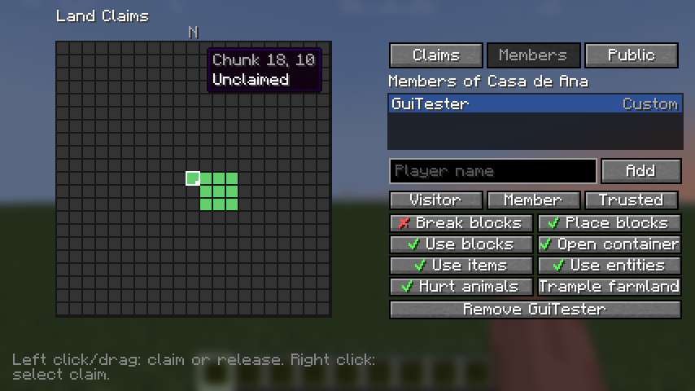
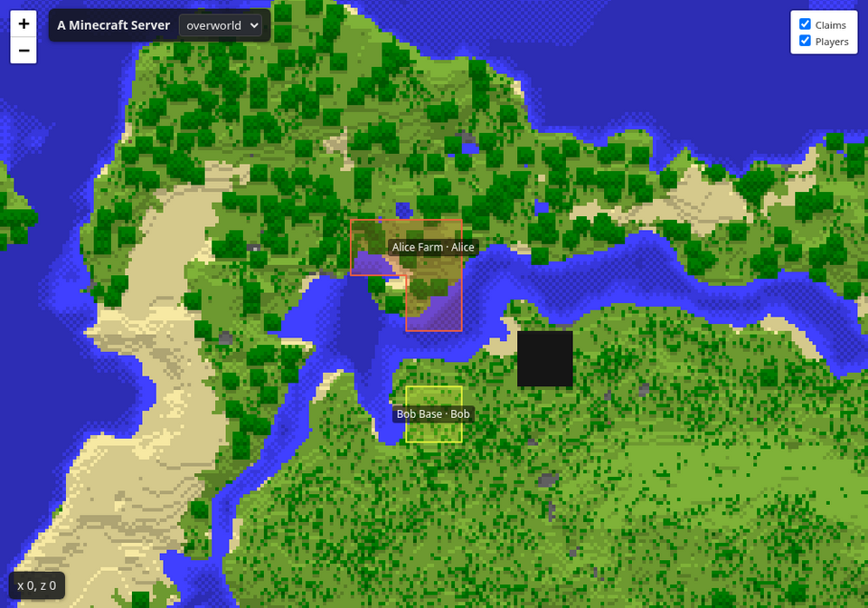
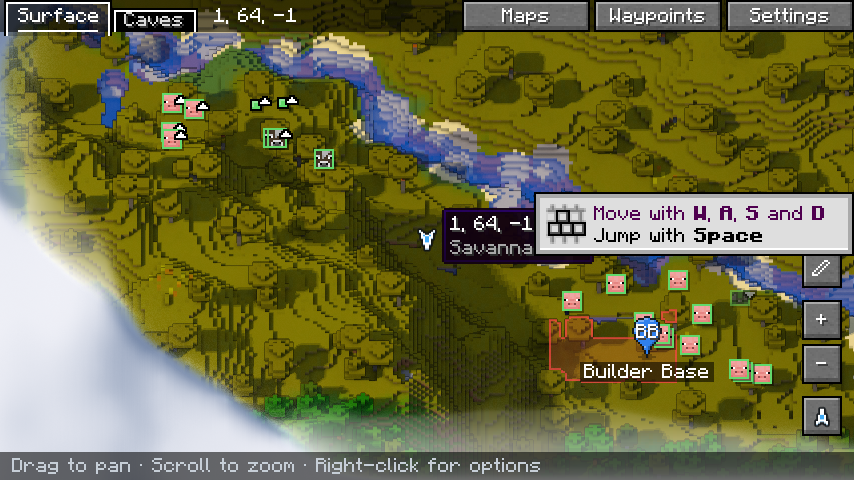
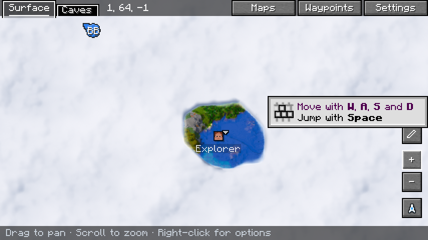

# Diorama Addons

Land claims, a web map and shared maps for Minecraft 1.21.1 on NeoForge. Four **independent** mods: each
one builds its own jar and works alone, and they work together when installed side by side.

| Mod | Mod ID | Install on | What it does |
|---|---|---|---|
| [Claims](#claims) | `dioaddons_claims` | Server (required), client (optional, for the screen) | Protect land chunk by chunk, add friends, set permissions |
| [Web Map](#web-map) | `dioaddons_webmap` | Server only | Live world map in the browser, with claims |
| [Client Map](#client-map-diorama) | `dioaddons_clientmap` | Server and clients with [Diorama](https://modrinth.com/mod/diorama-map) | Claims, shared explored map, shared waypoints and positions in Diorama |
| Claims API | `dioaddons_claims_api` | Nothing to do: bundled inside the other jars | Small read-only API other mods can use |
| Render Core | `dioaddons_render_core` | Nothing to do: bundled inside the jars that draw maps | Terrain shading in the Diorama style |

Players **without any of these mods can join** a server that has them; everything can also be done with
commands.

## Requirements and installation

- Minecraft **1.21.1** with **NeoForge 21.1.265** or newer.
- Download the jars from [Releases](../../releases) (each mod has its own, tagged `claims-v…`,
  `webmap-v…`, `clientmap-v…`) and put them in the `mods` folder of the server, and of the clients that
  need them (see the table).
- Client Map on the client needs **Diorama 0.7.0, 0.6.1 or 0.6.0** (`+neoforge-1.21.1`). Other Diorama versions are
  detected and left alone.

## Claims



- The unit is the **chunk**. Chunks of a claim touch each other; each player has limits on chunks and
  claims (being a friend in someone else's claim does not count).
- **Friends** get their own permissions, from templates (*Visitor*, *Member*, *Trusted*) or one by one.
  **Public** permissions apply to everyone else, plus claim settings: PvP, explosions, fire spread and mob
  griefing.
- Protects breaking and placing, doors and redstone, containers (vanilla and modded), item use, entities,
  animals, farmland, explosions, fire, fluids and pistons crossing the border, and mob griefing.
- Open the screen with **G** (change it in Controls) or `/claims menu`. The grid shows the real terrain
  around you in the style of the Diorama map, with each claim's colour and border on top. Left click or
  drag to claim or release; right click to select a claim.

| Command | |
|---|---|
| `/claim [name]` · `/unclaim` | Claim or release the chunk you stand in |
| `/claims list` · `/claims info` | Your claims and limits · the claim you stand in |
| `/claims rename <name>` · `/claims delete` | Edit the claim you stand in |
| `/claims trust <player> [visitor\|member\|trusted]` · `/claims untrust <player>` | Friends |
| `/claims permission public <permission> <true\|false>` | What everyone may do, and claim settings |
| `/claims permission member <player> <permission> <true\|false>` | One friend's permission |
| `/claims permission template <player> <template>` | Apply a template |
| `/claims admin bypass\|list [player]\|delete\|unclaim` | Operators |

Config: `serverconfig/dioaddons_claims-server.toml` in the world. Details: [permissions and
commands](docs/claims-permissions.md).

## Web Map



- Open `http://<server>:8123/`. Players install nothing.
- Drawn at an angle **in the style of the Diorama map**: real block textures, sun and shadows, trees and
  cliffs standing up. Tiles are rendered in the background from the saved world, at low priority and with
  a chunks-per-second cap; only changed areas are redrawn. The server keeps running if the port is taken.
- Vanilla textures come from the official Minecraft client jar, downloaded once from Mojang (about 27 MB,
  checked against Mojang's SHA-1); modded blocks use the textures in their own jars. Set
  `render.style = "TOP_DOWN"` for the older flat map that needs no download.
- With Claims installed, claims are painted on the terrain with a colour per owner, an edge where the owner
  changes and a label with the name and owner. Members and permissions are never published. Player
  positions are **off by default**.

| Command (operators) | |
|---|---|
| `/webmap status` | Web server, render queue, layers |
| `/webmap render [dimension]` | Render everything again |
| `/webmap clearcache` | Delete all tiles and start over |

Config: `config/dioaddons_webmap-common.toml` (port, bind address, render speed, dimensions, layers).
API: [docs/webmap-api.md](docs/webmap-api.md).

## Client Map (Diorama)

| | |
|---|---|
|  |  |

- **Claims** on Diorama's map and minimap, coloured by owner, "claim · owner" on hover. With Claims also on
  the client, right-click the map to **claim or release a chunk**.
- **Shared explored map:** places other players explored appear on your map, sent in the background.
- **Shared waypoints:** right-click → *Add shared waypoint here*; delete from the pin's menu.
- **Player positions** of your group on the map and radar. Hide yours with `/maplocation hide`.
- The server decides, separately for the explored map and for locations: off, shared by everyone, or by
  groups of friends.

| Command | |
|---|---|
| `/mapgroup create <name>` · `invite <player>` · `join <name>` · `leave` · `kick <player>` · `info` | Groups of friends |
| `/sharedwaypoint add <name>` · `list` · `rename <old> <new>` · `remove <name>` | Shared waypoints |
| `/maplocation show\|hide` | Share or hide your position |
| `/clientmap status` · `/clientmap resync` (client) | Sync state · send the explored map again |

Config: `config/dioaddons_clientmap-common.toml` on the server. How it hooks into Diorama:
[docs/clientmap-research.md](docs/clientmap-research.md).

## Building

```sh
./gradlew build                          # all mods + unit tests
./gradlew :claims:runGameTestServer      # in-world tests for claims
./gradlew :claims:runServer              # development server with one mod
```

Jars are written to `<module>/build/libs/`. More in [CONTRIBUTING.md](CONTRIBUTING.md).

## Documentation

- [Architecture and design decisions](docs/ARCHITECTURE.md)
- [Claims permissions and commands](docs/claims-permissions.md)
- [Web map HTTP API](docs/webmap-api.md)
- [Diorama research and integration plan](docs/clientmap-research.md)
- [Changelog](CHANGELOG.md)

## License

[MIT](LICENSE). Third-party notices (Leaflet) in [THIRD_PARTY.md](THIRD_PARTY.md). Diorama is a separate
project by its own authors and is not included.
