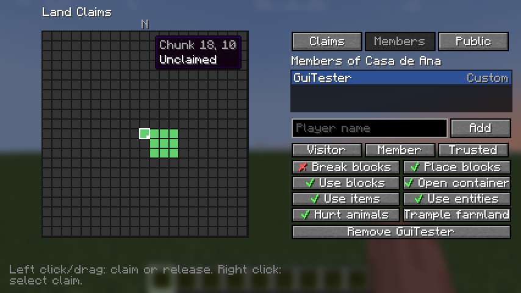

# Diorama Addons: Claims — listing for Modrinth and CurseForge

Everything needed to create the project page and upload version 0.1.0. Copy each block into the matching
field.

---

## 1. Project basics (both platforms)

| Field | Value |
|---|---|
| Name | `Diorama Addons: Claims` |
| Slug / URL | `diorama-addons-claims` |
| Icon | `contents/icons/claims-icon.png` (512×512 PNG, under 256 KiB) |
| License | MIT |
| Source code | `https://github.com/lorspi/diorama-addons` |
| Issue tracker | `https://github.com/lorspi/diorama-addons/issues` |
| Wiki / docs | `https://github.com/lorspi/diorama-addons/blob/main/docs/claims-permissions.md` |

### Summary (Modrinth "Summary", max 256 chars · CurseForge "Summary")

```
Protect your land chunk by chunk. Invite friends, give each one their own permissions and manage it all from an in-game screen — or with commands, so players without the mod can join too.
```

## 2. Modrinth fields

| Field | Value |
|---|---|
| Project type | Mod |
| Categories (primary) | `Management`, `Utility` |
| Additional categories | `Social`, `Game Mechanics` |
| Client side | Optional |
| Server side | Required |

## 3. CurseForge fields

| Field | Value |
|---|---|
| Project type | Mods |
| Main category | Server Utility |
| Additional categories | Utility & QoL, Miscellaneous |

---

## 4. Description (Markdown — paste it in both platforms)

> On CurseForge switch the editor to Markdown before pasting. The images point to the GitHub repository; if
> it is private, upload them to the gallery first and replace the URLs.

```markdown
# Diorama Addons: Claims

**Protect your land chunk by chunk, share it with your friends and decide exactly what each of them can do — from a real in-game screen.**



Claims is a land protection mod for NeoForge 1.21.1 servers. Players claim the chunks they live in, invite friends and set permissions one by one or with ready-made templates. Everything works from a graphical screen when the mod is on the client, and from commands when it is not, so **vanilla players can still join and play**.

## Features

- 🧱 **Chunk-based claims** — claim whole 16×16 columns. Chunks of the same claim stay connected.
- 🗺️ **Map-style claim screen** — press **G** (or `/claims menu`) to see the real terrain around you, drawn in the style of the Diorama map, with every claim's colour and border on top. Click or drag to claim or release.
- 👥 **Friends with their own permissions** — add a friend and pick a template (*Visitor*, *Member*, *Trusted*), or toggle each permission individually.
- 🌍 **Public permissions** — choose what everyone else may do in your claim.
- ⚙️ **Claim settings** — PvP, explosions, fire spread and mob griefing, per claim.
- 📏 **Per-player limits** — maximum chunks and claims per player. Being a friend in someone else's claim never counts against your own limits.
- 🛡️ **Solid protection** — breaking and placing blocks, doors and redstone, containers (vanilla and modded), item use, entities, animals, farmland trampling, explosions, fire, fluids and pistons crossing the border, and mob griefing.
- 🔧 **Operator tools** — bypass protection and list, edit or delete any claim.
- 💾 **Safe storage** — data is saved with the world in a versioned format.
- 🌐 **English and Spanish**, translated on the server so vanilla clients read them too.

## Installation

| Where | Needed? |
|---|---|
| Server | **Required** |
| Client | Optional — only for the claim screen. Without it, use the commands. |

Requires **Minecraft 1.21.1** and **NeoForge 21.1.265 or newer**. No other mods needed.

## Commands

| Command | What it does |
|---|---|
| `/claim [name]` · `/unclaim` | Claim or release the chunk you stand in |
| `/claims menu` | Open the claim screen (client mod) |
| `/claims list` · `/claims info` | Your claims and limits · the claim you stand in |
| `/claims rename <name>` · `/claims delete` | Edit the claim you stand in |
| `/claims trust <player> [visitor\|member\|trusted]` · `/claims untrust <player>` | Manage friends |
| `/claims permission public <permission> <true\|false>` | What everyone may do, and claim settings |
| `/claims permission member <player> <permission> <true\|false>` | One friend's permission |
| `/claims permission template <player> <template>` | Apply a template to a friend |
| `/claims admin bypass\|list [player]\|delete\|unclaim` | Operator tools |

**Permissions:** break blocks, place blocks, interact with blocks (doors, buttons, levers), open containers, use items, interact with entities, damage animals, trample farmland. **Claim settings:** PvP, explosions, fire spread, mob griefing.

Server config: `serverconfig/dioaddons_claims-server.toml` inside the world folder.
Full reference: [permissions and commands](https://github.com/lorspi/diorama-addons/blob/main/docs/claims-permissions.md).

## Works great with

- **[Diorama Addons: Web Map](https://modrinth.com/mod/diorama-addons-webmap)** — your claims painted on a live web map.
- **[Diorama Addons: Client Map](https://modrinth.com/mod/diorama-addons-clientmap)** — your claims on the Diorama map, plus claim/release from the map.

Each mod works alone; together they share claims automatically.

## About

Diorama Addons is an unofficial, community-made set of addons inspired by the [Diorama](https://modrinth.com/mod/diorama-map) map mod. It is not affiliated with or endorsed by the Diorama authors.

Open source under the MIT license — [source code and issues on GitHub](https://github.com/lorspi/diorama-addons).
```

---

## 5. Version 0.1.0 upload

| Field | Value |
|---|---|
| File | `claims/build/libs/diorama-addons-claims-1.21.1-0.1.0.jar` (not the `-sources` jar) |
| Version name | `Claims 0.1.0` |
| Version number | `0.1.0+1.21.1` |
| Release channel | Beta |
| Loaders | NeoForge |
| Game versions | 1.21.1 |
| Environment (CurseForge) | Server, Client |
| Java (CurseForge) | Java 21 |
| Dependencies | None (Claims API and Render Core are bundled inside the jar) |

### Changelog

```markdown
First release.

- Chunk-based claims with per-player limits (chunks and claims), connected chunks and an optional distance from spawn.
- Friends with their own permissions and templates (Visitor, Member, Trusted); public permissions and claim settings (PvP, explosions, fire spread, mob griefing).
- Claim screen with the real terrain around you in the style of the Diorama map, drag selection, claim list, members and public tabs (key **G** or `/claims menu`).
- Commands for players without the client mod: `/claim`, `/unclaim`, `/claims ...`, `/claims admin ...`.
- Protection for blocks, containers, items, entities, animals, farmland, explosions, fire, fluids, pistons and mob griefing.
- English and Spanish, translated on the server.
```

## 6. Gallery

| Image | Title | Description |
|---|---|---|
| `docs/images/claims-gui.png` (set as featured) | Claim screen | Real terrain around you with claims, members and permissions. |
| `docs/images/webmap-claims.png` | Claims on the web map | With Diorama Addons: Web Map installed. |
| `docs/images/diorama-claims-waypoints.png` | Claims on the Diorama map | With Diorama Addons: Client Map installed. |

## 7. Notes before publishing

- Create the three projects first so the slugs in "Works great with" exist; on CurseForge replace those
  links with the CurseForge project URLs.
- The icon uses the Diorama artwork. Ask the Diorama author for permission before publishing it.
