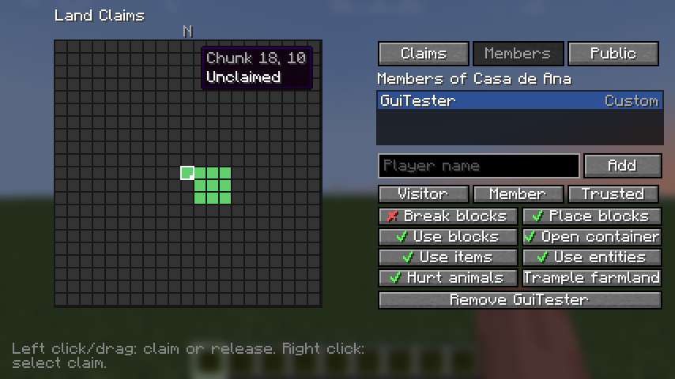

# Diorama Addons: Claims — ficha para Modrinth y CurseForge (versión en español)

Traducción de `listing.en.md` para revisar el contenido. **En las plataformas se publica la versión en
inglés**; esta es solo de referencia.

---

## 1. Datos del proyecto (ambas plataformas)

| Campo | Valor |
|---|---|
| Nombre | `Diorama Addons: Claims` |
| Slug / URL | `diorama-addons-claims` |
| Icono | `contents/icons/claims-icon.png` (PNG 512×512, menos de 256 KiB) |
| Licencia | MIT |
| Código fuente | `https://github.com/lorspi/diorama-addons` |
| Reporte de errores | `https://github.com/lorspi/diorama-addons/issues` |
| Wiki / documentación | `https://github.com/lorspi/diorama-addons/blob/main/docs/claims-permissions.md` |

### Resumen (Modrinth "Summary", máx. 256 caracteres · CurseForge "Summary")

```
Protege tu terreno chunk por chunk. Invita a tus amigos, dale a cada uno sus propios permisos y gestiona todo desde una pantalla en el juego — o con comandos, para que también entren jugadores sin el mod.
```

## 2. Campos de Modrinth

| Campo | Valor |
|---|---|
| Tipo de proyecto | Mod |
| Categorías principales | `Management`, `Utility` |
| Categorías adicionales | `Social`, `Game Mechanics` |
| Lado cliente | Opcional |
| Lado servidor | Obligatorio |

## 3. Campos de CurseForge

| Campo | Valor |
|---|---|
| Tipo de proyecto | Mods |
| Categoría principal | Server Utility |
| Categorías adicionales | Utility & QoL, Miscellaneous |

---

## 4. Descripción

```markdown
# Diorama Addons: Claims

**Protege tu terreno chunk por chunk, compártelo con tus amigos y decide exactamente qué puede hacer cada uno — desde una pantalla de verdad dentro del juego.**



Claims es un mod de protección de terreno para servidores NeoForge 1.21.1. Los jugadores reclaman los chunks donde viven, invitan a sus amigos y configuran los permisos uno por uno o con plantillas listas. Todo funciona desde una pantalla gráfica cuando el mod está en el cliente, y con comandos cuando no, así que **los jugadores vanilla también pueden entrar y jugar**.

## Características

- 🧱 **Claims por chunk** — reclama columnas completas de 16×16. Los chunks de un mismo claim quedan unidos.
- 🗺️ **Pantalla con estilo de mapa** — pulsa **G** (o `/claims menu`) para ver el terreno real a tu alrededor, dibujado al estilo del mapa de Diorama, con el color y el borde de cada claim encima. Haz clic o arrastra para reclamar o liberar.
- 👥 **Amigos con sus propios permisos** — añade un amigo y elige una plantilla (*Visitante*, *Miembro*, *Confiable*), o activa cada permiso por separado.
- 🌍 **Permisos públicos** — elige qué puede hacer cualquier otro jugador en tu claim.
- ⚙️ **Ajustes del claim** — PvP, explosiones, propagación del fuego y destrozos de mobs, por claim.
- 📏 **Límites por jugador** — máximo de chunks y de claims por jugador. Ser amigo en el claim de otro nunca cuenta para tus propios límites.
- 🛡️ **Protección completa** — romper y colocar bloques, puertas y redstone, contenedores (vanilla y de mods), uso de objetos, entidades, animales, pisoteo de cultivos, explosiones, fuego, fluidos y pistones que cruzan el borde, y destrozos de mobs.
- 🔧 **Herramientas para operadores** — ignorar la protección y listar, editar o borrar cualquier claim.
- 💾 **Guardado seguro** — los datos se guardan con el mundo en un formato versionado.
- 🌐 **Inglés y español**, traducidos en el servidor para que también los lean los clientes vanilla.

## Instalación

| Dónde | ¿Necesario? |
|---|---|
| Servidor | **Obligatorio** |
| Cliente | Opcional — solo para la pantalla de claims. Sin él, usa los comandos. |

Requiere **Minecraft 1.21.1** y **NeoForge 21.1.265 o superior**. No necesita otros mods.

## Comandos

| Comando | Qué hace |
|---|---|
| `/claim [nombre]` · `/unclaim` | Reclama o libera el chunk donde estás |
| `/claims menu` | Abre la pantalla de claims (mod en el cliente) |
| `/claims list` · `/claims info` | Tus claims y límites · el claim donde estás |
| `/claims rename <nombre>` · `/claims delete` | Edita el claim donde estás |
| `/claims trust <jugador> [visitor\|member\|trusted]` · `/claims untrust <jugador>` | Gestiona amigos |
| `/claims permission public <permiso> <true\|false>` | Lo que puede hacer cualquiera, y ajustes del claim |
| `/claims permission member <jugador> <permiso> <true\|false>` | Un permiso de un amigo |
| `/claims permission template <jugador> <plantilla>` | Aplica una plantilla a un amigo |
| `/claims admin bypass\|list [jugador]\|delete\|unclaim` | Herramientas de operador |

**Permisos:** romper bloques, colocar bloques, interactuar con bloques (puertas, botones, palancas), abrir contenedores, usar objetos, interactuar con entidades, dañar animales, pisotear cultivos. **Ajustes del claim:** PvP, explosiones, propagación del fuego, destrozos de mobs.

Configuración del servidor: `serverconfig/dioaddons_claims-server.toml` dentro de la carpeta del mundo.
Referencia completa: [permisos y comandos](https://github.com/lorspi/diorama-addons/blob/main/docs/claims-permissions.md).

## Combina muy bien con

- **[Diorama Addons: Web Map](https://modrinth.com/mod/diorama-addons-webmap)** — tus claims pintados en un mapa web en vivo.
- **[Diorama Addons: Client Map](https://modrinth.com/mod/diorama-addons-clientmap)** — tus claims en el mapa de Diorama, y reclamar o liberar desde el mapa.

Cada mod funciona solo; juntos comparten los claims automáticamente.

## Acerca de

Diorama Addons es un conjunto de addons no oficial, hecho por la comunidad e inspirado en el mod de mapa [Diorama](https://modrinth.com/mod/diorama-map). No está afiliado ni respaldado por los autores de Diorama.

Código abierto con licencia MIT — [código fuente e incidencias en GitHub](https://github.com/lorspi/diorama-addons).
```

---

## 5. Subida de la versión 0.1.0

| Campo | Valor |
|---|---|
| Archivo | `claims/build/libs/diorama-addons-claims-1.21.1-0.1.0.jar` (no el jar `-sources`) |
| Nombre de la versión | `Claims 0.1.0` |
| Número de versión | `0.1.0+1.21.1` |
| Canal | Beta |
| Loaders | NeoForge |
| Versiones del juego | 1.21.1 |
| Entorno (CurseForge) | Server, Client |
| Java (CurseForge) | Java 21 |
| Dependencias | Ninguna (Claims API y Render Core van dentro del jar) |

### Changelog

```markdown
Primera versión.

- Claims por chunk con límites por jugador (chunks y claims), chunks unidos y distancia mínima al spawn opcional.
- Amigos con sus propios permisos y plantillas (Visitante, Miembro, Confiable); permisos públicos y ajustes del claim (PvP, explosiones, propagación del fuego, destrozos de mobs).
- Pantalla de claims con el terreno real a tu alrededor al estilo del mapa de Diorama, selección arrastrando, lista de claims, pestañas de miembros y público (tecla **G** o `/claims menu`).
- Comandos para jugadores sin el mod en el cliente: `/claim`, `/unclaim`, `/claims ...`, `/claims admin ...`.
- Protección de bloques, contenedores, objetos, entidades, animales, cultivos, explosiones, fuego, fluidos, pistones y destrozos de mobs.
- Inglés y español, traducidos en el servidor.
```

## 6. Galería

| Imagen | Título | Descripción |
|---|---|---|
| `docs/images/claims-gui.png` (marcar como destacada) | Pantalla de claims | El terreno real a tu alrededor con claims, miembros y permisos. |
| `docs/images/webmap-claims.png` | Claims en el mapa web | Con Diorama Addons: Web Map instalado. |
| `docs/images/diorama-claims-waypoints.png` | Claims en el mapa de Diorama | Con Diorama Addons: Client Map instalado. |

## 7. Antes de publicar

- Crea primero los tres proyectos para que existan los slugs de "Combina muy bien con"; en CurseForge cambia
  esos enlaces por las URLs de los proyectos en CurseForge.
- El icono usa la ilustración de Diorama. Pide permiso al autor de Diorama antes de publicarlo.
