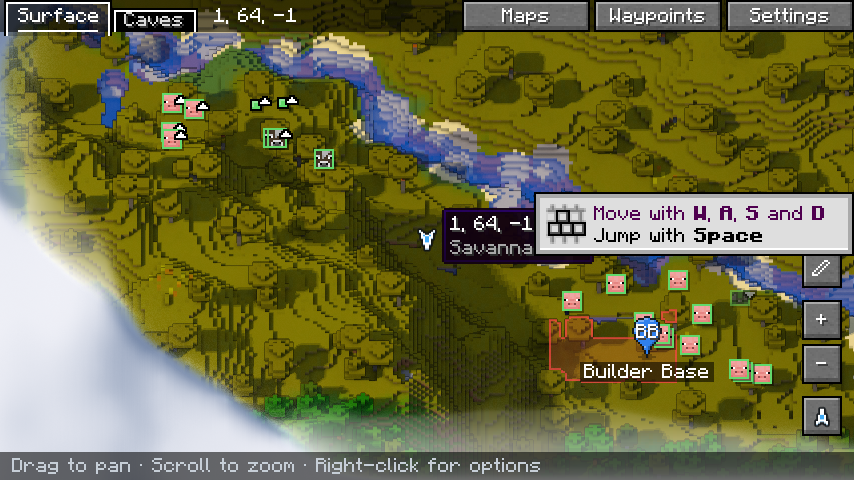
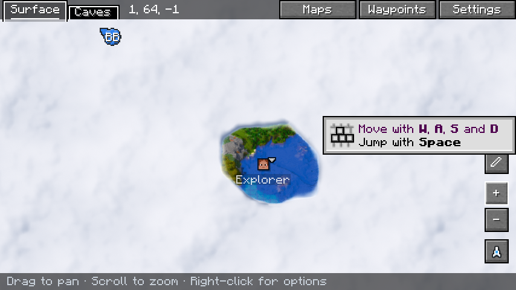

# Diorama Addons: Client Map — listing for Modrinth and CurseForge

Everything needed to create the project page and upload version 0.1.0. Copy each block into the matching
field.

---

## 1. Project basics (both platforms)

| Field | Value |
|---|---|
| Name | `Diorama Addons: Client Map` |
| Slug / URL | `diorama-addons-clientmap` |
| Icon | `contents/icons/clientmap-icon.png` (512×512 PNG, under 256 KiB) |
| License | MIT |
| Source code | `https://github.com/lorspi/diorama-addons` |
| Issue tracker | `https://github.com/lorspi/diorama-addons/issues` |
| Wiki / docs | `https://github.com/lorspi/diorama-addons/blob/main/docs/clientmap-research.md` |

### Summary (Modrinth "Summary", max 256 chars · CurseForge "Summary")

```
Multiplayer features for the Diorama map: land claims, a shared explored map, shared waypoints and player positions with privacy. The server decides what is shared: off, everyone or groups of friends.
```

## 2. Modrinth fields

| Field | Value |
|---|---|
| Project type | Mod |
| Categories (primary) | `Social`, `Utility` |
| Additional categories | `Transportation` |
| Client side | Optional |
| Server side | Required |

## 3. CurseForge fields

| Field | Value |
|---|---|
| Project type | Mods |
| Main category | Map and Information |
| Additional categories | Server Utility, Utility & QoL |

---

## 4. Description (Markdown — paste it in both platforms)

> On CurseForge switch the editor to Markdown before pasting. The images point to the GitHub repository; if
> it is private, upload them to the gallery first and replace the URLs.

```markdown
# Diorama Addons: Client Map

**Make the Diorama map a multiplayer map: see land claims, share what you explored, share waypoints and see your friends — all inside Diorama.**

| | |
|---|---|
|  |  |

Client Map connects your NeoForge 1.21.1 server with the [Diorama](https://modrinth.com/mod/diorama-map) map on each player's client. The server keeps the shared data and sends it in the background; Diorama shows it.

## Features

- 🚩 **Claims on the map** — claims from [Diorama Addons: Claims](https://modrinth.com/mod/diorama-addons-claims) appear on Diorama's map and minimap, coloured by owner, with "claim · owner" on hover.
- 🖱️ **Claim from the map** — with Claims also installed on the client, right-click any chunk on the map to **claim or release it**. The server checks every action.
- 🧭 **Shared explored map** — places other players explored show up on your map, sent in the background in small batches.
- 📍 **Shared waypoints** — right-click → *Add shared waypoint here*. Everyone in your group sees it; only its owner, the group owner or an operator can rename or delete it.
- 👀 **Player positions with privacy** — see your group on the map and radar. Hide yourself any time with `/maplocation hide`.
- 👪 **Groups of friends** — the server chooses, separately for exploration and for locations: **off**, **shared by everyone**, or **by groups** (`/mapgroup`).
- ✅ **Safe to install** — players without the mod (or without Diorama) can still join; without Diorama the mod simply does nothing.

## Installation

| Where | Needed? |
|---|---|
| Server | **Required** — stores and shares the data |
| Client | Optional — install it, together with **Diorama 0.7.0** (or 0.6.x), to see everything on the map |

Requires **Minecraft 1.21.1**, **NeoForge 21.1.265 or newer** and, on the client, **Diorama `0.7.0`, `0.6.1` or `0.6.0` (`+neoforge-1.21.1`)**. Other Diorama versions are detected and left alone.

Optional: [Diorama Addons: Claims](https://modrinth.com/mod/diorama-addons-claims) on the server for claims, and on the client to claim from the map.

## Commands

| Command | What it does |
|---|---|
| `/mapgroup create <name>` · `invite <player>` · `join <name>` · `leave` · `kick <player>` · `info` | Groups of friends |
| `/sharedwaypoint add <name>` · `list` · `rename <old> <new>` · `remove <name>` | Shared waypoints |
| `/maplocation show\|hide` | Share or hide your position |
| `/clientmap status` · `/clientmap resync` (client) | Sync state · send the explored map again |

Server config: `config/dioaddons_clientmap-common.toml`.

## Known limitations

- Supports **Diorama 0.6.0, 0.6.1 and 0.7.0**; each new Diorama release has to be checked.
- Shared waypoints are listed in Diorama's *Waystones* folder.
- Shared explored chunks show the surface only (no caves).

## Works great with

- **[Diorama Addons: Claims](https://modrinth.com/mod/diorama-addons-claims)** — land protection with friends and permissions.
- **[Diorama Addons: Web Map](https://modrinth.com/mod/diorama-addons-webmap)** — the same world, in the browser.

## About

Diorama Addons is an unofficial, community-made set of addons for the [Diorama](https://modrinth.com/mod/diorama-map) map mod. It is not affiliated with or endorsed by the Diorama authors, and Diorama is not included.

Open source under the MIT license — [source code and issues on GitHub](https://github.com/lorspi/diorama-addons).
```

---

## 5. Version 0.1.0 upload

| Field | Value |
|---|---|
| File | `clientmap/build/libs/diorama-addons-clientmap-1.21.1-0.1.0.jar` (not the `-sources` jar) |
| Version name | `Client Map 0.1.0` |
| Version number | `0.1.0+1.21.1` |
| Release channel | Beta |
| Loaders | NeoForge |
| Game versions | 1.21.1 |
| Environment (CurseForge) | Client, Server |
| Java (CurseForge) | Java 21 |
| Dependencies | Diorama — **Optional** (needed on the client to see anything) · Diorama Addons: Claims — **Optional** |

### Changelog

```markdown
First release.

- Integration with Diorama 0.6.0 (NeoForge 1.21.1): claims on the map and minimap, claim/release from the right-click menu.
- Shared explored map, sent in batches with a rate limit.
- Shared waypoints with an owner; player positions with per-player privacy (`/maplocation`).
- Sharing modes per server, separately for exploration and locations: disabled, global or by groups (`/mapgroup`).
- Commands: `/mapgroup`, `/sharedwaypoint`, `/maplocation`, client `/clientmap status|resync`.
```

## 6. Gallery

| Image | Title | Description |
|---|---|---|
| `docs/images/diorama-claims-waypoints.png` (set as featured) | Claims and shared waypoints | Claims coloured by owner and a shared waypoint on the Diorama map. |
| `docs/images/diorama-shared-explored.png` | Shared explored map | Terrain explored by another player appears on your map. |

Suggested extra captures: the right-click menu with "Claim chunk", and the minimap with another player.

## 7. Notes before publishing

- On Modrinth, Diorama is `https://modrinth.com/mod/diorama-map`; add it as an **Optional** dependency.
  On CurseForge, add it as **Optional Dependency** only if Diorama has a CurseForge project.
- Create the three projects first so the slugs in "Works great with" exist; on CurseForge replace those
  links with the CurseForge project URLs.
- The icon uses the Diorama artwork. Ask the Diorama author for permission before publishing it.
