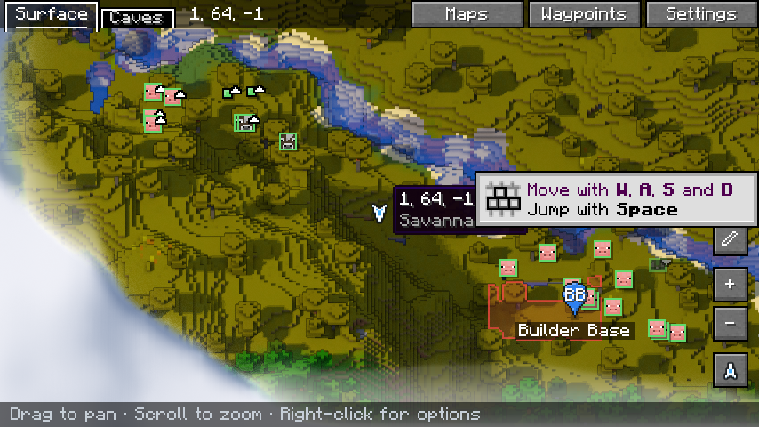
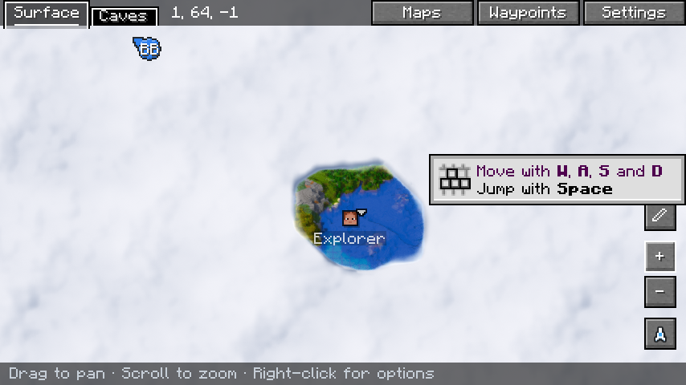

# Diorama Addons: Client Map — ficha para Modrinth y CurseForge (versión en español)

Traducción de `listing.en.md` para revisar el contenido. **En las plataformas se publica la versión en
inglés**; esta es solo de referencia.

---

## 1. Datos del proyecto (ambas plataformas)

| Campo | Valor |
|---|---|
| Nombre | `Diorama Addons: Client Map` |
| Slug / URL | `diorama-addons-clientmap` |
| Icono | `contents/icons/clientmap-icon.png` (PNG 512×512, menos de 256 KiB) |
| Licencia | MIT |
| Código fuente | `https://github.com/lorspi/diorama-addons` |
| Reporte de errores | `https://github.com/lorspi/diorama-addons/issues` |
| Wiki / documentación | `https://github.com/lorspi/diorama-addons/blob/main/docs/clientmap-research.md` |

### Resumen (Modrinth "Summary", máx. 256 caracteres · CurseForge "Summary")

```
Funciones multijugador para el mapa de Diorama: claims, mapa explorado compartido, waypoints compartidos y posiciones de jugadores con privacidad. El servidor decide qué se comparte: nada, con todos o por grupos.
```

## 2. Campos de Modrinth

| Campo | Valor |
|---|---|
| Tipo de proyecto | Mod |
| Categorías principales | `Social`, `Utility` |
| Categorías adicionales | `Transportation` |
| Lado cliente | Opcional |
| Lado servidor | Obligatorio |

## 3. Campos de CurseForge

| Campo | Valor |
|---|---|
| Tipo de proyecto | Mods |
| Categoría principal | Map and Information |
| Categorías adicionales | Server Utility, Utility & QoL |

---

## 4. Descripción

```markdown
# Diorama Addons: Client Map

**Convierte el mapa de Diorama en un mapa multijugador: ve los claims, comparte lo que exploraste, comparte waypoints y ve a tus amigos — todo dentro de Diorama.**

| | |
|---|---|
|  |  |

Client Map conecta tu servidor NeoForge 1.21.1 con el mapa de [Diorama](https://modrinth.com/mod/diorama-map) en el cliente de cada jugador. El servidor guarda los datos compartidos y los envía en segundo plano; Diorama los muestra.

## Características

- 🚩 **Claims en el mapa** — los claims de [Diorama Addons: Claims](https://modrinth.com/mod/diorama-addons-claims) aparecen en el mapa y el minimapa de Diorama, con color por propietario y "claim · dueño" al pasar el ratón.
- 🖱️ **Reclamar desde el mapa** — con Claims también en el cliente, haz clic derecho en cualquier chunk del mapa para **reclamarlo o liberarlo**. El servidor valida cada acción.
- 🧭 **Mapa explorado compartido** — los lugares que exploraron otros jugadores aparecen en tu mapa, enviados en segundo plano en lotes pequeños.
- 📍 **Waypoints compartidos** — clic derecho → *Add shared waypoint here*. Todo tu grupo lo ve; solo su dueño, el dueño del grupo o un operador pueden renombrarlo o borrarlo.
- 👀 **Posiciones con privacidad** — ve a tu grupo en el mapa y el radar. Ocúltate cuando quieras con `/maplocation hide`.
- 👪 **Grupos de amigos** — el servidor elige, por separado para la exploración y para las ubicaciones: **desactivado**, **compartido con todos** o **por grupos** (`/mapgroup`).
- ✅ **Seguro de instalar** — los jugadores sin el mod (o sin Diorama) pueden entrar igual; sin Diorama el mod simplemente no hace nada.

## Instalación

| Dónde | ¿Necesario? |
|---|---|
| Servidor | **Obligatorio** — guarda y comparte los datos |
| Cliente | Opcional — instálalo junto con **Diorama 0.6.0** para verlo todo en el mapa |

Requiere **Minecraft 1.21.1**, **NeoForge 21.1.265 o superior** y, en el cliente, **Diorama `0.6.0+neoforge-1.21.1`**. Otras versiones de Diorama se detectan y se dejan tal cual.

Opcional: [Diorama Addons: Claims](https://modrinth.com/mod/diorama-addons-claims) en el servidor para los claims, y en el cliente para reclamar desde el mapa.

## Comandos

| Comando | Qué hace |
|---|---|
| `/mapgroup create <nombre>` · `invite <jugador>` · `join <nombre>` · `leave` · `kick <jugador>` · `info` | Grupos de amigos |
| `/sharedwaypoint add <nombre>` · `list` · `rename <viejo> <nuevo>` · `remove <nombre>` | Waypoints compartidos |
| `/maplocation show\|hide` | Comparte u oculta tu posición |
| `/clientmap status` · `/clientmap resync` (cliente) | Estado de la sincronización · reenvía el mapa explorado |

Configuración del servidor: `config/dioaddons_clientmap-common.toml`.

## Limitaciones conocidas

- Por ahora solo soporta **Diorama 0.6.0**; cada nueva versión de Diorama hay que comprobarla.
- Los waypoints compartidos aparecen en la carpeta *Waystones* de Diorama.
- Los chunks explorados compartidos muestran solo la superficie (sin cuevas).

## Combina muy bien con

- **[Diorama Addons: Claims](https://modrinth.com/mod/diorama-addons-claims)** — protección de terreno con amigos y permisos.
- **[Diorama Addons: Web Map](https://modrinth.com/mod/diorama-addons-webmap)** — el mismo mundo, en el navegador.

## Acerca de

Diorama Addons es un conjunto de addons no oficial, hecho por la comunidad, para el mod de mapa [Diorama](https://modrinth.com/mod/diorama-map). No está afiliado ni respaldado por los autores de Diorama, y Diorama no está incluido.

Código abierto con licencia MIT — [código fuente e incidencias en GitHub](https://github.com/lorspi/diorama-addons).
```

---

## 5. Subida de la versión 0.1.0

| Campo | Valor |
|---|---|
| Archivo | `clientmap/build/libs/diorama-addons-clientmap-1.21.1-0.1.0.jar` (no el jar `-sources`) |
| Nombre de la versión | `Client Map 0.1.0` |
| Número de versión | `0.1.0+1.21.1` |
| Canal | Beta |
| Loaders | NeoForge |
| Versiones del juego | 1.21.1 |
| Entorno (CurseForge) | Client, Server |
| Java (CurseForge) | Java 21 |
| Dependencias | Diorama — **Opcional** (hace falta en el cliente para ver algo) · Diorama Addons: Claims — **Opcional** |

### Changelog

```markdown
Primera versión.

- Integración con Diorama 0.6.0 (NeoForge 1.21.1): claims en el mapa y el minimapa, reclamar o liberar desde el menú de clic derecho.
- Mapa explorado compartido, enviado por lotes con límite de tasa.
- Waypoints compartidos con propietario; posiciones de jugadores con privacidad por jugador (`/maplocation`).
- Modos de compartir por servidor, por separado para exploración y ubicaciones: desactivado, global o por grupos (`/mapgroup`).
- Comandos: `/mapgroup`, `/sharedwaypoint`, `/maplocation`, y en el cliente `/clientmap status|resync`.
```

## 6. Galería

| Imagen | Título | Descripción |
|---|---|---|
| `docs/images/diorama-claims-waypoints.png` (marcar como destacada) | Claims y waypoints compartidos | Claims coloreados por propietario y un waypoint compartido en el mapa de Diorama. |
| `docs/images/diorama-shared-explored.png` | Mapa explorado compartido | El terreno que exploró otro jugador aparece en tu mapa. |

Capturas extra sugeridas: el menú de clic derecho con "Claim chunk" y el minimapa con otro jugador.

## 7. Antes de publicar

- En Modrinth, Diorama es `https://modrinth.com/mod/diorama-map`; añádelo como dependencia **Optional**.
  En CurseForge, añádelo como **Optional Dependency** solo si Diorama tiene proyecto en CurseForge.
- Crea primero los tres proyectos para que existan los slugs de "Combina muy bien con"; en CurseForge cambia
  esos enlaces por las URLs de los proyectos en CurseForge.
- El icono usa la ilustración de Diorama. Pide permiso al autor de Diorama antes de publicarlo.
