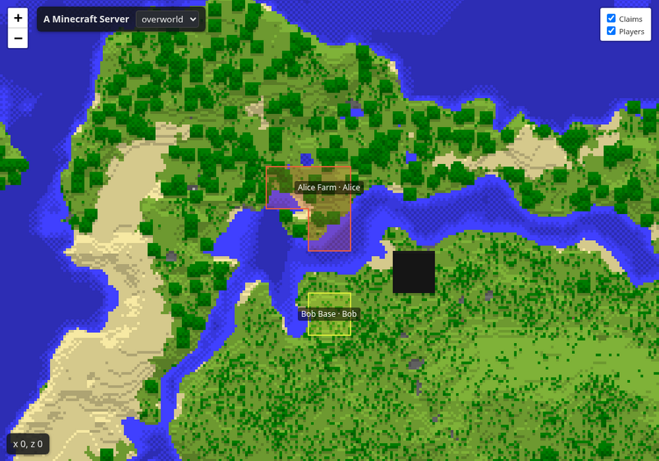

# Diorama Addons: Web Map — listing for Modrinth and CurseForge

Everything needed to create the project page and upload version 0.3.0. Copy each block into the matching
field.

---

## 1. Project basics (both platforms)

| Field | Value |
|---|---|
| Name | `Diorama Addons: Web Map` |
| Slug / URL | `diorama-addons-webmap` |
| Icon | `contents/icons/webmap-icon.png` (512×512 PNG, under 256 KiB) |
| License | MIT |
| Source code | `https://github.com/lorspi/diorama-addons` |
| Issue tracker | `https://github.com/lorspi/diorama-addons/issues` |
| Wiki / docs | `https://github.com/lorspi/diorama-addons/blob/main/docs/webmap-api.md` |

### Summary (Modrinth "Summary", max 256 chars · CurseForge "Summary")

```
A live map of your server in the browser, drawn in the Diorama style with real textures, sun and shadows. Server-side: players install nothing. Shows land claims, players and chat.
```

## 2. Modrinth fields

| Field | Value |
|---|---|
| Project type | Mod |
| Categories (primary) | `Utility`, `Management` |
| Additional categories | `Social` |
| Client side | Optional (only for the in-game settings screen) |
| Server side | Required |

## 3. CurseForge fields

| Field | Value |
|---|---|
| Project type | Mods |
| Main category | Map and Information |
| Additional categories | Server Utility |

---

## 4. Description

```markdown
# Diorama Addons: Web Map

**Your whole world in the browser — drawn at an angle like the Diorama map, with real block textures, sun and shadows.**



Web Map runs inside your NeoForge 1.21.1 server and serves a live map at `http://<your-server>:8123/`. Players do not install anything: they just open a link.

## Features

- 🏰 **Diorama style** — the world is drawn at an angle from real block textures, with sun, shadows and outlines. Trees and cliffs stand out from the map.
- 🧩 **Modded blocks drawn right** — they use the textures in their own jars.
- ⚡ **Live** — newly explored or edited terrain shows up within seconds, even before the game saves it. Open pages reload only the tiles that changed.
- 🐢 **Light on the server** — tiles are rendered in the background at low priority with a chunks-per-second cap; live checks use a small time budget per tick.
- 🔍 **Zoom, dimensions and spawn** — zoom levels, a selector for every dimension you enable and a button that centres the map on the spawn point.
- 🚩 **Land claims** — claims from [Diorama Addons: Claims](https://modrinth.com/mod/diorama-addons-claims) or Mochos Esenciales are painted on the terrain with a colour per owner and a label with the claim name and owner. Members and permissions are never published.
- 💬 **Chat and online list** — optional read-only public chat (joins and leaves included) and list of connected players.
- ☑️ **Layer check boxes** — visitors show or hide claims, players and chat; the browser remembers the choice.
- ⚙️ **In-game settings** — operators with the mod on their client change the title, icon and layers from a screen (mod list → Config, or `/webmap config`). Everything is also in the config file and applies without a restart.
- 🔒 **Private by default** — player positions and chat are **off** until you enable them, since the map may be public.
- 🛟 **Never crashes your server** — if the port is busy it logs a clear error and the game keeps running.
- 🗂️ **JSON API** — `/api/info`, `/api/claims`, `/api/players`, `/api/chat` and `/api/changes` for your own tools.
- 📄 **Flat map option** — set `render.style = "TOP_DOWN"` for a classic top-down map.

## Installation

| Where | Needed? |
|---|---|
| Server | **Required** |
| Client | Optional — only for the in-game settings screen |

Requires **Minecraft 1.21.1** and **NeoForge 21.1.265 or newer**.

1. Drop the jar into the server's `mods` folder and start it.
2. Open `http://<server-address>:8123/` in a browser.
3. Change the port, bind address, render speed, dimensions, title, icon and layers in `config/dioaddons_webmap-common.toml` (or in the game with `/webmap config`).

> **First start:** the Diorama style reads vanilla textures from the official Minecraft client jar, downloaded once from Mojang (about 27 MB, checked against Mojang's SHA-1). The `TOP_DOWN` style needs no download.

## Commands (operators)

| Command | What it does |
|---|---|
| `/webmap status` | Web server, render queue and layers |
| `/webmap render [dimension]` | Render everything again |
| `/webmap clearcache` | Delete all tiles and start over |
| `/webmap reload` | Apply changes made to the config file |
| `/webmap restart` | Restart the web server only |
| `/webmap config` | Open the settings screen (needs the mod on your client) |

HTTP API reference: [docs/webmap-api.md](https://github.com/lorspi/diorama-addons/blob/main/docs/webmap-api.md).

## Works great with

- **[Diorama Addons: Claims](https://modrinth.com/mod/diorama-addons-claims)** — land protection; its claims appear on the web map.
- **[Diorama Addons: Client Map](https://modrinth.com/mod/diorama-addons-clientmap)** — claims, shared exploration and waypoints inside the Diorama map.

Each mod works alone; together they share claims automatically.

## About

Diorama Addons is an unofficial, community-made set of addons inspired by the [Diorama](https://modrinth.com/mod/diorama-map) map mod. It is not affiliated with or endorsed by the Diorama authors. The web interface uses [Leaflet](https://leafletjs.com) (BSD-2-Clause).

Open source under the MIT license — [source code and issues on GitHub](https://github.com/lorspi/diorama-addons).
```

---

## 5. Version 0.3.0 upload

| Field | Value |
|---|---|
| File | `webmap/build/libs/diorama-addons-webmap-1.21.1-0.3.0.jar` (not the `-sources` jar) |
| Version name | `Web Map 0.3.0` |
| Version number | `0.3.0+1.21.1` |
| Release channel | Beta |
| Loaders | NeoForge |
| Game versions | 1.21.1 |
| Environment (CurseForge) | Server (client optional) |
| Java (CurseForge) | Java 21 |
| Dependencies | None. Optional integrations: Diorama Addons: Claims, Mochos Esenciales |

### Changelog

```markdown
- **Live terrain:** newly explored or edited land appears on the map within seconds, without waiting for the autosave.
- **No more black when zooming out:** zoomed-out levels are refreshed while players explore.
- **Spawn button and marker** to centre the map on the spawn point.
- **Layer check boxes** on the page to show or hide claims, players and chat.
- **In-game settings screen** for operators (mod list → Config, or `/webmap config`): title, icon and the claims, players, online list and chat layers. Players without the mod can still join.
- **Mochos Esenciales support:** its land claims and its public chat are shown on the map (group and direct messages are never published).
- `web.favicon` files must be inside the server folder.
```

## 6. Gallery

| Image | Title | Description |
|---|---|---|
| `docs/images/webmap-claims.png` (set as featured) | Web map with claims | The world in the Diorama style, with claims painted on the terrain. |

Suggested extra captures: the layer check boxes and chat panel, the in-game settings screen, a zoomed-out view of a large area, the Nether, and the `TOP_DOWN` style.

## 7. Notes before publishing

- Create the three projects first so the slugs in "Works great with" exist; on CurseForge replace those
  links with the CurseForge project URLs.
- If you link Claims as a dependency, use type **Optional** (Modrinth) / **Optional Dependency**
  (CurseForge).
- The icon uses the Diorama artwork. Ask the Diorama author for permission before publishing it.
