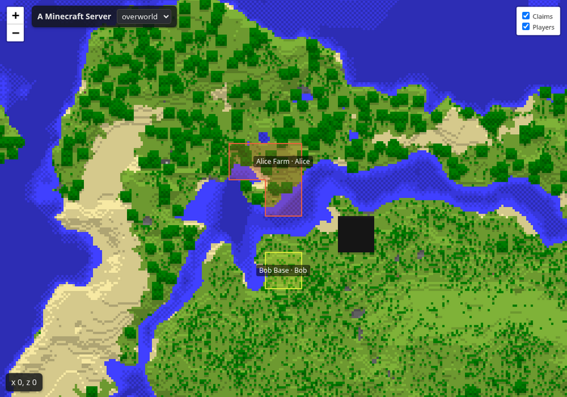

# Diorama Addons: Web Map — ficha para Modrinth y CurseForge (versión en español)

Traducción de `listing.en.md` para revisar el contenido. **En las plataformas se publica la versión en
inglés**; esta es solo de referencia.

---

## 1. Datos del proyecto (ambas plataformas)

| Campo | Valor |
|---|---|
| Nombre | `Diorama Addons: Web Map` |
| Slug / URL | `diorama-addons-webmap` |
| Icono | `contents/icons/webmap-icon.png` (PNG 512×512, menos de 256 KiB) |
| Licencia | MIT |
| Código fuente | `https://github.com/lorspi/diorama-addons` |
| Reporte de errores | `https://github.com/lorspi/diorama-addons/issues` |
| Wiki / documentación | `https://github.com/lorspi/diorama-addons/blob/main/docs/webmap-api.md` |

### Resumen (Modrinth "Summary", máx. 256 caracteres · CurseForge "Summary")

```
Un mapa en vivo de tu servidor en el navegador, al estilo Diorama con texturas reales, sol y sombras. Lado servidor: los jugadores no instalan nada. Muestra terrenos, jugadores y chat.
```

## 2. Campos de Modrinth

| Campo | Valor |
|---|---|
| Tipo de proyecto | Mod |
| Categorías principales | `Utility`, `Management` |
| Categorías adicionales | `Social` |
| Lado cliente | Opcional (solo para la pantalla de configuración en el juego) |
| Lado servidor | Obligatorio |

## 3. Campos de CurseForge

| Campo | Valor |
|---|---|
| Tipo de proyecto | Mods |
| Categoría principal | Map and Information |
| Categorías adicionales | Server Utility |

---

## 4. Descripción

```markdown
# Diorama Addons: Web Map

**Todo tu mundo en el navegador — dibujado en ángulo al estilo del mapa de Diorama, con texturas reales de bloques, sol y sombras.**



Web Map corre dentro de tu servidor NeoForge 1.21.1 y sirve un mapa en vivo en `http://<tu-servidor>:8123/`. Los jugadores no instalan nada: solo abren un enlace.

## Características

- 🏰 **Estilo Diorama** — el mundo se dibuja en ángulo a partir de las texturas reales de los bloques, con sol, sombras y contornos. Los árboles y acantilados sobresalen del mapa.
- 🧩 **Bloques de mods bien dibujados** — usan las texturas de sus propios jars.
- ⚡ **En vivo** — el terreno recién explorado o modificado aparece en segundos, incluso antes de que el juego lo guarde. Las páginas abiertas solo recargan los tiles que cambiaron.
- 🐢 **Ligero para el servidor** — los tiles se generan en segundo plano, con baja prioridad y un límite de chunks por segundo; las comprobaciones en vivo usan un pequeño presupuesto de tiempo por tick.
- 🔍 **Zoom, dimensiones y spawn** — niveles de zoom, un selector para cada dimensión activada y un botón que centra el mapa en el punto de aparición.
- 🚩 **Terrenos** — los claims de [Diorama Addons: Claims](https://modrinth.com/mod/diorama-addons-claims) o de Mochos Esenciales se pintan sobre el terreno con un color por propietario y una etiqueta con el nombre del terreno y su dueño. Los miembros y permisos nunca se publican.
- 💬 **Chat y conectados** — chat público opcional de solo lectura (con entradas y salidas) y lista de jugadores conectados.
- ☑️ **Casillas de capas** — los visitantes muestran u ocultan terrenos, jugadores y chat; el navegador recuerda la elección.
- ⚙️ **Configuración en el juego** — los operadores con el mod en su cliente cambian el título, el icono y las capas desde una pantalla (lista de mods → Config, o `/webmap config`). Todo está también en el archivo de configuración y se aplica sin reiniciar.
- 🔒 **Privado por defecto** — las posiciones de los jugadores y el chat están **desactivados** hasta que los actives, porque el mapa puede ser público.
- 🛟 **Nunca tumba el servidor** — si el puerto está ocupado, registra un error claro y el juego sigue funcionando.
- 🗂️ **API JSON** — `/api/info`, `/api/claims`, `/api/players`, `/api/chat` y `/api/changes` para tus propias herramientas.
- 📄 **Opción de mapa plano** — usa `render.style = "TOP_DOWN"` para un mapa cenital clásico.

## Instalación

| Dónde | ¿Necesario? |
|---|---|
| Servidor | **Obligatorio** |
| Cliente | Opcional — solo para la pantalla de configuración en el juego |

Requiere **Minecraft 1.21.1** y **NeoForge 21.1.265 o superior**.

1. Pon el jar en la carpeta `mods` del servidor y arráncalo.
2. Abre `http://<dirección-del-servidor>:8123/` en un navegador.
3. Cambia el puerto, la dirección de enlace, la velocidad de renderizado, las dimensiones, el título, el icono y las capas en `config/dioaddons_webmap-common.toml` (o en el juego con `/webmap config`).

> **Primer arranque:** el estilo Diorama usa las texturas vanilla del jar oficial del cliente de Minecraft, que se descarga una vez desde Mojang (unos 27 MB, verificado con el SHA-1 de Mojang). El estilo `TOP_DOWN` no necesita descarga.

## Comandos (operadores)

| Comando | Qué hace |
|---|---|
| `/webmap status` | Servidor web, cola de renderizado y capas |
| `/webmap render [dimensión]` | Vuelve a renderizar todo |
| `/webmap clearcache` | Borra todos los tiles y empieza de nuevo |
| `/webmap reload` | Aplica los cambios del archivo de configuración |
| `/webmap restart` | Reinicia solo el servidor web |
| `/webmap config` | Abre la pantalla de configuración (necesita el mod en tu cliente) |

Referencia de la API HTTP: [docs/webmap-api.md](https://github.com/lorspi/diorama-addons/blob/main/docs/webmap-api.md).

## Combina muy bien con

- **[Diorama Addons: Claims](https://modrinth.com/mod/diorama-addons-claims)** — protección de terreno; sus claims aparecen en el mapa web.
- **[Diorama Addons: Client Map](https://modrinth.com/mod/diorama-addons-clientmap)** — claims, exploración compartida y waypoints dentro del mapa de Diorama.

Cada mod funciona solo; juntos comparten los claims automáticamente.

## Acerca de

Diorama Addons es un conjunto de addons no oficial, hecho por la comunidad e inspirado en el mod de mapa [Diorama](https://modrinth.com/mod/diorama-map). No está afiliado ni respaldado por los autores de Diorama. La interfaz web usa [Leaflet](https://leafletjs.com) (BSD-2-Clause).

Código abierto con licencia MIT — [código fuente e incidencias en GitHub](https://github.com/lorspi/diorama-addons).
```

---

## 5. Subida de la versión 0.3.0

| Campo | Valor |
|---|---|
| Archivo | `webmap/build/libs/diorama-addons-webmap-1.21.1-0.3.0.jar` (no el jar `-sources`) |
| Nombre de la versión | `Web Map 0.3.0` |
| Número de versión | `0.3.0+1.21.1` |
| Canal | Beta |
| Loaders | NeoForge |
| Versiones del juego | 1.21.1 |
| Entorno (CurseForge) | Server (cliente opcional) |
| Java (CurseForge) | Java 21 |
| Dependencias | Ninguna. Integraciones opcionales: Diorama Addons: Claims, Mochos Esenciales |

### Changelog

```markdown
- **Terreno en vivo:** las zonas recién exploradas o modificadas aparecen en el mapa en segundos, sin esperar al autoguardado.
- **Se acabó el negro al alejarse:** los niveles alejados se actualizan mientras los jugadores exploran.
- **Botón y marcador de spawn** para centrar el mapa en el punto de aparición.
- **Casillas de capas** en la página para mostrar u ocultar terrenos, jugadores y chat.
- **Pantalla de configuración en el juego** para operadores (lista de mods → Config, o `/webmap config`): título, icono y las capas de terrenos, jugadores, lista de conectados y chat. Los jugadores sin el mod pueden entrar igual.
- **Soporte para Mochos Esenciales:** sus terrenos y su chat público se muestran en el mapa (los mensajes de grupo y directos nunca se publican).
- Los archivos de `web.favicon` deben estar dentro de la carpeta del servidor.
```

## 6. Galería

| Imagen | Título | Descripción |
|---|---|---|
| `docs/images/webmap-claims.png` (marcar como destacada) | Mapa web con claims | El mundo al estilo Diorama, con los claims pintados sobre el terreno. |

Capturas extra sugeridas: las casillas de capas y el panel de chat, la pantalla de configuración en el juego, una vista alejada de una zona grande, el Nether y el estilo `TOP_DOWN`.

## 7. Antes de publicar

- Crea primero los tres proyectos para que existan los slugs de "Combina muy bien con"; en CurseForge cambia
  esos enlaces por las URLs de los proyectos en CurseForge.
- Si enlazas Claims como dependencia, usa el tipo **Optional** (Modrinth) / **Optional Dependency**
  (CurseForge).
- El icono usa la ilustración de Diorama. Pide permiso al autor de Diorama antes de publicarlo.
